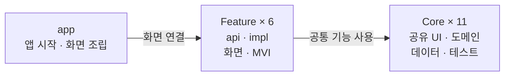
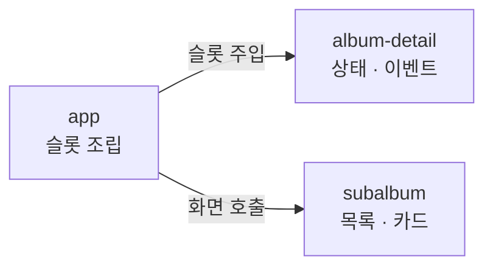

# Momentwo : 순간순간

<!-- PROJECT LOGO -->


## 📝 프로젝트 소개

```
📚 계정 없이 순간을 기록하고, 원할 때 함께 공유하자
```

### 앨범 하나로 추억들을 함께, 쉽게 정리

> - 다양한 사람과 만든 추억들, Momentwo에서 같이 모으고 정리해보세요.
> - 앨범에 참여한 사람들과 서브 앨범을 활용해 사진을 체계적으로 관리해보세요.
> - 사진을 올려 그 날의 기억, 감정들을 공유해보세요.
> - 공유된 사진에 좋아요, 댓글을 남겨 추억을 함께 떠올려보세요.

## 계정 없이 시작하기

앱을 열면 **내 로컬 앨범**으로 시작합니다. 가입·로그인·인터넷 없이 앨범과 서브앨범을 만들고 사진·설명·개인 메모·즐겨찾기를 관리할 수 있습니다. 사진은 앱의 영속 저장소에 복사하며 가져온 원본은 변경하지 않습니다.

| 기본 로컬 사용 | 선택한 계정 기능 |
|---|---|
| 앨범·서브앨범·대표 사진·소제목 관리 | 계정 앨범과 친구·초대·멤버 관리 |
| 영속 사진 보관·열람·삭제·갤러리 내보내기 | 저장된 계정 사진의 오프라인 열람과 변경 동기화 |
| 설명·개인 메모·즐겨찾기 | 공유 댓글·좋아요 |

**계정 연결 → 기기 앨범 복사·동기화**에서 복사할 앨범과 대상 계정을 확인합니다. 로그인만으로 업로드하지 않습니다. 복사는 시작 시점의 앨범·서브앨범·사진·설명을 대상으로 하며 원래 기기 자료와 개인 메모·즐겨찾기를 유지합니다. 복사 이후 두 자료는 독립적으로 편집합니다.

계정 작업은 기기에 저장한 뒤 이어갑니다. 충돌은 서버 값과 내 변경을 비교해 선택하며, 서버 반영 여부가 불명확하면 자동 재전송하지 않습니다. 기존 API가 생성 ID를 반환하지 않는 경우 실제 서버 항목을 사용자가 확인해 연결합니다. 백엔드 복구 후 실제 전송 검증은 [#150](https://github.com/Momentwo/Momentwo/issues/150)에서 진행합니다.

[저장·복사·복구 가이드](docs/architecture/offline-first-guide.md) · [구현·검증 기록](docs/architecture/offline-first-plan.md) · [기기·계정 UI 공통화](docs/architecture/library-ui-parity.md)

## 🔗 Links

<a href="https://www.figma.com/design/9BrDrys4FBGbLddElob9fe/Momentwo-App?node-id=0-1&node-type=CANVAS" target="_blank"></a> <!-- Figma -->
<a href="https://github.com/orgs/Momentwo/projects/2/views/1" target="_blank"></a> <!-- Projects -->
<a href="https://github.com/Momentwo/.github/wiki" target="_blank"></a> <!-- Wiki -->
<a href="https://docs.google.com/spreadsheets/d/1YRfMq25zHXb-t9I5BtCy1J-0f9CEuApI4UbKw0r2kqg/edit?gid=0#gid=0" target="_blank"></a> <!-- Google Sheet -->

---

## 👨🏻‍💻팀원 소개🧑🏻‍💻

|                                     |                                    |
|:-----------------------------------:|:----------------------------------:|
| [이지우](https://github.com/CordHouse) | [김재현](https://github.com/eoeo0326) |

---

## 🖼️ App 한눈에 보기

아래 이미지는 기존 계정·공유 화면입니다. 기본 진입과 로컬 기능은 위 사용 흐름을 참고해주세요.

|  |  |  |
|:---------------------------------------------------------------------------------------------------------:|:---------------------------------------------------------------------------------------------------------:|:---------------------------------------------------------------------------------------------------------:|
|                                                   앨범 목록                                                   |                                                   앨범 생성                                                   |                                                   친구 초대                                                   |
|  |  |  |
|                                               앨범 (서브 앨범 목록)                                               |                                                    멤버                                                     |                                                   앨범 설정                                                   |
|  |  |  |
|                                                   사진 목록                                                   |                                          사진 목록 옵션 (DropdownMenu)                                          |                                               사진 삭제 (목록 선택)                                               |
|  |  |  |
|                                                  사진 디테일                                                   |                                                   사진 설명                                                   |                                                   사진 댓글                                                   |
|  |  |                                                                                                           |
|                                                   친구 목록                                                   |                                                 친구 요청 목록                                                  |                                                                                                           |
|  |  |                                                                                                           |
|                                                    로그인                                                    |                                                   회원가입                                                    |                                                                                                           |

<details>
    <summary><b>Dark Theme</b></summary>
        <table>
            <tr>
                <td></td>
                <td></td>
                <td></td>
            </tr>
            <tr>
                <td>앨범 목록</td>
                <td>앨범 생성</td>
                <td>친구 초대</td>
            </tr>
            <tr>
                <td></td>
                <td></td>
                <td></td>
            </tr>
            <tr>
                <td>앨범 (서브 앨범 목록)</td>
                <td>멤버</td>
                <td>앨범 설정</td>
            </tr>
            <tr>
                <td></td>
                <td></td>
                <td></td>
            </tr>
            <tr>
                <td>사진 목록</td>
                <td>사진 목록 옵션 (DropdownMenu)</td>
                <td>사진 삭제 (목록 선택)</td>
            </tr>
            <tr>
                <td></td>
                <td></td>
                <td></td>
            </tr>
            <tr>
                <td>사진 디테일</td>
                <td>사진 설명</td>
                <td>사진 댓글</td>
            </tr>
            <tr>
                <td></td>
                <td></td>
                <td></td>
            </tr>
            <tr>
                <td>친구 목록</td>
                <td>친구 요청 목록</td>
                <td></td>
            </tr>
      </table>
</details>

---

## 🔎 주요 기능 소개

### 앨범

|  |
|:---------------------------------------------------------------------------------------------------------:|
|                                               홈 화면 - 앨범 생성                                                |

- 앨범 목록 화면에서 각 앨범의 대표 사진, 제목, 소제목을 확인할 수 있습니다.

- 우측 하단의 ‘+’ 버튼을 클릭하여 새로운 앨범을 생성할 수 있습니다.

    - 앨범을 생성할 때 앨범을 함께 사용할 친구를 초대할 수 있습니다.

|  |  |
|:---------------------------------------------------------------------------------------------------------:|:---------------------------------------------------------------------------------------------------------:|
|                                                 서브 앨범 목록                                                  |                                                   멤버 목록                                                   |

- 앨범을 클릭하면 해당 앨범의 서브 앨범 목록을 확인할 수 있습니다.

    - 우측 상단

- 앨범에 속한 멤버 목록을 확인할 수 있습니다.

    - 우측 상단의 "+" 버튼을 눌러 친구를 초대할 수 있습니다.
    - 앨범의 관리자는 우측 상단 설정 버튼을 눌러 멤버를 관리할 수 있습니다.

|  |  |  |
|:---------------------------------------------------------------------------------------------------------:|:---------------------------------------------------------------------------------------------------------:|:---------------------------------------------------------------------------------------------------------:|
|                                                   앨범 설정                                                   |                                           앨범 제목, 부제목 변경 Dialog                                            |                                               앨범 대표 이미지 변경                                                |

- 앨범 제목, 대표 사진 등 앨범의 구성요소를 수정할 수 있습니다. (관리자 권한)

    - 관리자가 아닌 경우 일반 앨범 설정(앨범 나가기)만 사용할 수 있습니다.

<br/>

### 사진

|  |  |  |
|:---------------------------------------------------------------------------------------------------------:|:---------------------------------------------------------------------------------------------------------:|:---------------------------------------------------------------------------------------------------------:|
|                                                   사진 목록                                                   |                                          사진 목록 옵션 (DropdownMenu)                                          |                                               사진 삭제 (목록 선택)                                               |

- 서브 앨범에 정리한 사진들을 확인할 수 있습니다.

- 내가 좋아요를 남긴 사진은 사진 우하단 하트모양으로 표시됩니다.

- 우측 상단 + 버튼을 눌러 새로운 사진을 업로드할 수 있습니다.

- Dropdown Menu의 항목을 선택해 서브 앨범의 제목을 변경하거나 사진을 삭제할 수 있습니다.

|  |  |
|:---------------------------------------------------------------------------------------------------------:|:---------------------------------------------------------------------------------------------------------:|
|                                               사진 선택, 메뉴 토글                                                |                                                 사진 좋아요 토글                                                 |

- 사진 목록 화면에서 사진을 선택해 크게 볼 수 있습니다.

- 사진을 탭하여 상, 하단 메뉴를 가리고 사진에만 집중할 수 있습니다.

- 하단의 하트 버튼을 눌러 해당 사진에 좋아요를 남기거나 해제할 수 있습니다.

|  |  |
|:---------------------------------------------------------------------------------------------------------:|:---------------------------------------------------------------------------------------------------------:|
|                                                 사진 설명 작성                                                  |                                                 사진 설명 수정                                                  |

- 사진에 대한 설명을 작성하여 공유할 수 있습니다.

- 추가할 내용이 있다면 언제든 수정할 수 있습니다.

|  |
|:---------------------------------------------------------------------------------------------------------:|
|                                                   사진 댓글                                                   |

- 사진에 댓글을 남겨 사진에 대한 이야기를 나눌 수 있습니다.

- 댓글을 길게 눌러 댓글 내용을 수정하거나, 삭제할 수 있습니다.

> **구현 중인 기능**
> - 다른 서브 앨범으로 사진 이동

<br/>

### 친구

|  |
|:---------------------------------------------------------------------------------------------------------:|
|                                               친구 목록 / 요청 목록                                               |

- 홈 화면 죄측 Drawer를 통해 친구 화면으로 이동할 수 있습니다.
- 친구 화면에서는 친구 목록을 조회하고, 친구 요청을 관리할 수 있습니다.
- 우측 상단 친구 추가 버튼을 통해 사용자를 검색하고 친구 요청을 보낼 수 있습니다. (구현 예정)

> **구현 중인 기능**
> - 사용자 검색 (검색 엔진), 친구 요청 보내기

<br/>

### 검색

- 구현 예정
- 업로드 날짜 범위 검색
- 타이틀, 앨범 설명, 사진 설명 String 단위 검색

<br/>

### 로그인

|  |  |
|:---------------------------------------------------------------------------------------------------------:|:---------------------------------------------------------------------------------------------------------:|
|                                                    로그인                                                    |                                                   회원가입                                                    |

- 이메일을 이용해 회원가입하고 Momentwo의 서비스를 이용할 수 있습니다.

> **구현 중인 기능**
> - 아이디/비밀번호 찾기

---

## 🏗️ 모듈 구조

`app` 1개, Core 11개, Feature 6개 × `api`/`impl`로 구성한 **24개 Gradle 모듈**입니다. `build-logic`은 `includeBuild`로 연결한 별도 빌드이며 모듈 수에 포함하지 않습니다.

### 구조도

앱 조립, 화면 구현, 공통 기능의 세 영역으로 나눕니다. app이 Feature를 연결하고, Feature impl이 필요한 Core 모듈을 사용합니다.



app은 Theme·공용 모델에도 직접 의존합니다. 모듈별 전체 의존과 테스트 의존은 [실제 모듈 의존성](docs/architecture/module-graph.md)에서 확인할 수 있습니다.

### 디렉터리 구성

```text
Momentwo/
├── app/                         # 앱 시작과 Feature 조립
├── core/
│   ├── model/                   # 순수 Kotlin 모델
│   ├── common/                  # MVI 기반, Dispatcher
│   ├── designsystem/            # Theme와 디자인 토큰
│   ├── ui/                      # 도메인 공유 UI
│   ├── domain/                  # UseCase
│   ├── data/                    # Repository, DTO, Service, DataSource
│   ├── network/                 # HTTP 클라이언트와 인증
│   ├── database/                # Room 저장소
│   ├── datastore/               # 토큰과 세션 설정
│   ├── navigation/              # 공용 Navigation 모듈 (현재 소스 없음)
│   └── testing/                 # MainDispatcherRule
├── feature/                     # 각 Feature 아래 api/와 impl/
│   ├── auth/
│   ├── friend/
│   ├── subalbum/
│   ├── album-detail/
│   ├── album/
│   └── photo/
└── build-logic/
    └── convention/              # 공통 Gradle 설정과 plugin
```

### Core 모듈의 책임

| 모듈 | 책임 |
|---|---|
| `core:model` | AlbumItem·PhotoItem 등 공용 모델. Android에 의존하지 않는 Kotlin JVM 모듈 |
| `core:common` | ReducerViewModel·순수 Reducer, ScreenState·요청·취소 기반, Coroutine Dispatcher·시작 훅 계약 |
| `core:designsystem` | Compose Theme, 색상·타이포그래피 등 디자인 토큰 |
| `core:ui` | AlbumItemCard·UserItemBox·Dialog 등 도메인 공유 Composable |
| `core:domain` | 여러 화면에서 사용하는 UseCase |
| `core:data` | Repository 인터페이스·구현, DTO·Service·DataSource·RemoteMediator, 영속 파일·선택 복사·JobScheduler 동기화 |
| `core:network` | Retrofit·OkHttp·Moshi 설정, 인증 Interceptor/Authenticator, BASE_URL |
| `core:database` | Room v4, 로컬 원본·계정별 캐시·동기화 작업·연결 정보, 명시적 migration |
| `core:datastore` | Preferences DataStore 기반 원자적 계정 세션·편집 초안 저장 |
| `core:navigation` | 공용 Navigation 확장용 모듈. 경로 키는 Feature API로 이동했고 현재 공용 소스는 없음 |
| `core:testing` | 코루틴 ViewModel 테스트에 사용하는 MainDispatcherRule |

### Feature 모듈의 책임

각 Feature의 `api`는 `@Serializable` 경로 키와 이동 인자를 공개합니다. `impl`은 화면·Composable Route·ViewModel·분리된 MVI State/Event/Action/Effect·내부 그래프를 소유합니다. app은 공개 그래프 등록 함수와 콜백으로 화면을 연결합니다.

| Feature | 화면과 기능 |
|---|---|
| `auth` | 로그인, 회원가입, Profile |
| `friend` | 친구 목록·검색·요청, 목록/요청 내부 탭 |
| `subalbum` | 서브앨범 목록·카드 렌더링, 클릭·선택 콜백 |
| `album-detail` | 앨범 상세·멤버·설정·대표 이미지, 서브앨범 상태·편집·CRUD, 내부 탭 그래프 |
| `album` | 기본 로컬 앨범·계정 연결·선택 복사·동기화, 기존 계정 앨범 목록·생성 |
| `photo` | 로컬/계정 사진·설명·개인 메모·즐겨찾기·공유 댓글/좋아요·몰입 모드 |

`subalbum`은 독립 ViewModel 없이 화면을 렌더링합니다. 목록·선택·편집 상태와 API 요청은 `album-detail`이 소유하고, app의 `SubAlbumContentAdapter`가 두 impl을 Composable 슬롯으로 연결합니다.

<details>
<summary>SubAlbum 화면 연결 상세</summary>



AlbumDetail이 전달한 목록·선택 상태와 콜백을 app의 어댑터가 SubAlbum 화면에 연결합니다. 내부 목적지 키는 `subalbum:api`를 사용하며, 두 impl은 서로 의존하지 않습니다.

</details>

### 의존성과 MVI 규칙

- app이 루트 NavHost, 화면 이동 콜백, Feature 간 화면 조립을 담당합니다.
- Feature convention plugin의 기본 Core 의존은 `ui`, `designsystem`, `domain`, `navigation`입니다. `common`, `model`, `data`와 Coil·Paging 등은 실제 사용에 따라 직접 선언합니다.
- Feature impl은 자신의 API와 필요한 Core에 의존합니다. 다른 Feature를 직접 참조할 때는 API만 사용합니다. 현재 서로 다른 Feature 사이의 직접 의존은 `album-detail:impl → subalbum:api`입니다.
- `Core → Feature`, `Feature → app`, `impl → 다른 Feature impl`, `api → impl/data` 의존은 금지합니다. 현재 모든 Feature API는 serialization 런타임만 사용하며 Core 의존이 없습니다.
- Repository 인터페이스는 `core:data`, UseCase는 `core:domain`, UI 공용 모델은 `core:model`에 둡니다.

MVI는 `core:common`의 `ReducerViewModel`과 순수 Reducer를 사용합니다. Feature ViewModel은 UI Event를 Main에서 처리하고 Action으로 최신 State를 갱신합니다. 최초 데이터는 `ScreenState`의 Loading/Success/Error로 구분하며 새로고침 중에는 기존 콘텐츠와 입력·선택을 유지합니다.

화면은 `StateFlow`를 `collectAsStateWithLifecycle()`로 수집하고, `Channel(BUFFERED)` Effect를 STARTED에서 처리합니다. 조회는 최신 요청만 반영하고 동일 쓰기는 중복 차단합니다. 취소는 오류 UI로 변환하지 않습니다. Paging 표시 상태는 LoadState에서 파생하며 SubAlbum 상태는 AlbumDetail이 소유합니다. 세부 규칙과 한계는 [MVI 구현 가이드](docs/architecture/mvi-guide.md)에 정리했습니다.

---

## 🗃️ Tech Stacks

| 분류 | 기술 | 사용처 |
|---|---|---|
| Language | Kotlin | 앱·Core·Feature 및 Gradle Kotlin DSL |
| Architecture | 멀티모듈, Feature api/impl, MVI, ViewModel | 모듈 경계, 순수 Reducer와 State/Event/Action/Effect |
| UI | Jetpack Compose, Material 3 | 선언형 UI, Theme·공유 컴포넌트 |
| Navigation | Navigation Compose, SavedStateHandle | 타입 기반 경로·인자 복원, 루트/중첩 NavHost |
| Async | Kotlin Coroutines, Flow | 취소 보존 요청, StateFlow·Paging Flow·Channel Effect |
| Dependency Injection | Hilt, KSP | Repository·UseCase·ViewModel 주입과 코드 생성 |
| Network | Retrofit, OkHttp | HTTP API, 인증 Interceptor/Authenticator |
| Serialization | Moshi, Kotlinx Serialization | HTTP JSON 변환 / Navigation 경로 직렬화 |
| Local Storage | Room, Preferences DataStore, 앱 영속 파일 | 로컬 원본·계정별 캐시·대기 작업 / 세션·편집 초안 / 사진 보관 |
| Background Sync | Android JobScheduler | 사용자가 저장한 계정 작업의 연결 복구·재시작 후 이어가기 |
| Paging | Paging 3, RemoteMediator | 페이지 단위 로딩과 Room/원격 데이터 연동 |
| Image | Coil 3, Coil Compose | 이미지 로딩·Compose 표시, HTTP Cache-Control 유지 |
| Testing | JUnit 4, Coroutines Test, AndroidX Test, Compose UI Test | Reducer·요청·취소 회귀, 경로·lifecycle·Paging·Room 기기 검증 |
| Build | Gradle Kotlin DSL, Version Catalog, Convention Plugins | 의존성·버전·공통 Android/Compose/Hilt 설정 관리 |

라이브러리와 plugin 버전 선언은 [gradle/libs.versions.toml](gradle/libs.versions.toml), 공통 빌드 설정은 [build-logic/convention](build-logic/convention)에서 관리합니다.

---

기기·계정·기존 회원 경로는 같은 앨범 카드·상세 탭·사진 그리드·전체 화면 뷰어와 BottomSheet를 공유합니다. 저장소와 권한은 각 Route/ViewModel이 유지하고, Feature를 넘는 서브앨범 미리보기 카드는 `core:ui`가 제공합니다. 생성은 별도 화면에서 완료하며, 선택 삭제는 부모 UUID를 검증하는 단일 transaction으로 처리합니다.

기기 사진의 하단 메뉴는 **설명·즐겨찾기·개인 메모·갤러리 내보내기**, 계정 사진은 **설명·공유 좋아요·공유 댓글·내보내기**입니다. 계정 사진의 개인 기록과 즐겨찾기는 더보기 메뉴에서 관리합니다. 로그인 안내를 다녀와도 기기 자료와 초안은 유지됩니다.

## 개발 환경과 검증

| 항목 | 프로젝트 설정 |
|---|---|
| Gradle 실행 JDK / 컴파일 toolchain | Temurin 25.0.4.1+1 LTS |
| Java / Kotlin JVM 출력 대상 | 17 |
| Kotlin / Compose Compiler / Serialization plugin | 2.4.21 |
| Gradle Wrapper / Android Gradle Plugin | 9.7.0 / 9.3.3 |
| Android SDK | minSdk 29, compileSdk 37, targetSdk 36 |

터미널의 `JAVA_HOME`과 Android Studio의 **Gradle JDK**를 Temurin 25로 맞춥니다. IDE 자체는 기본 JBR을 사용합니다. JVM 출력 대상은 17로 유지하며 JDK 25 전용 API를 앱에 추가하지 않습니다.

`local.properties`에 `sdk.dir`과 기존 `BASE_URL` 설정이 필요합니다. BASE_URL의 BuildConfig는 `core:network`가 생성합니다. 로컬 설정과 인증 정보는 커밋하지 않습니다.

핵심 도구 전환 #189와 후속 라이브러리·targetSdk 업데이트 #190의 순서와 검증 기준은 [빌드 도구 업데이트](docs/architecture/toolchain-upgrade.md)에 정리했습니다.

### 빌드·Lint·단위 테스트

```bash
./gradlew checkArchitecture
./gradlew clean :core:model:test assembleDebug lintDebug testDebugUnitTest
```

모듈 경계·import와 운영/단위/기기 테스트 맥락별 의존 사이클을 검사합니다. 각 모듈의 `check`에도 연결되어 있습니다. PR CI는 경계 검사·전체 단위 테스트·Debug·Lint를 실행하고, `develop` 반영 후 Release·계측 APK 빌드를 추가합니다. 운영 인증 정보 없이 실행하며, 계측 APK 빌드는 기기 테스트 실행과 구분합니다. [검사 규칙·로컬 실행·CI 가이드](docs/architecture/module-boundaries.md)를 참고하세요.

### 기기 Navigation 테스트

```bash
./gradlew :app:connectedDebugAndroidTest
```

연결된 테스트 기기에서 `AppNavigationSmokeTest`가 실제 app 그래프·Hilt·경로·탭·백스택·SubAlbum 슬롯, 상태별 UI·Paging·Effect lifecycle·시스템 바를 확인합니다. `PhotoCacheTransactionSmokeTest`는 별도 in-memory DB에서 Room 저장 범위와 취소 롤백을 검증합니다. 기본 명령은 제품과 동일한 applicationId를 사용하므로 서명이 맞는 테스트 설치 환경에서 실행합니다. 원본 앱을 보존한 별도 패키지 검증 과정은 [Phase 2 실행 기록](docs/architecture/phase2-feature-migration-plan.md)에 정리했습니다.

2026-10-12 마이그레이션 검증은 clean 빌드·Lint·Feature 단위 테스트 18개·기기 테스트 7개를 통과했습니다. 당시 백엔드 배포 중단으로 실제 API 골든 패스와 정식 업데이트·복원은 미확인이며, [회귀 이슈 #150](https://github.com/Momentwo/Momentwo/issues/150)에서 추적합니다.

2026-10-13 #155 MVI 개선에서는 전체 clean 빌드·Lint·단위 테스트 123개와 SM_N976N API 31 별도 앱 기기 회귀 13개를 통과했습니다. 9개 ViewModel의 Reducer 전환과 구 기반 제거를 완료했으며, API 골든 패스는 계속 #150에서 추적합니다.

2026-10-14 #162 전환은 가입 없이 사용하는 로컬 라이브러리, 선택 계정 연결·복사와 영속 동기화를 추가했습니다. 전체 단위 테스트 161개·Debug/Release 빌드·Lint, 실제 비행기 모드와 프로세스 복원을 포함한 기기 테스트 36개를 통과했습니다. 최신 검증 결과와 미확인 항목은 [Offline-First 실행 기록](docs/architecture/offline-first-plan.md)에 정리합니다.

### 아키텍처 문서

- [모듈 경계·사이클 검사 및 CI](docs/architecture/module-boundaries.md)
- [Offline-First 저장·복사·복구 가이드](docs/architecture/offline-first-guide.md)
- [Offline-First 구현·검증 기록](docs/architecture/offline-first-plan.md)

- [MVI 구현 가이드](docs/architecture/mvi-guide.md)
- [MVI 개선·검증 기록](docs/architecture/mvi-improvement-plan.md)
- [실제 모듈 의존성](docs/architecture/module-graph.md)
- [멀티모듈 마이그레이션 결과와 계획](docs/architecture/multi-module-migration-plan.md)
- [Phase 2 구현·검증 기록](docs/architecture/phase2-feature-migration-plan.md)
- [Convention plugin 가이드](docs/architecture/build-logic-convention.md)

일반 라이브러리와 targetSdk의 단계별 버전·검증 기록은 [업데이트 가이드](docs/architecture/library-sdk-upgrade.md)에 정리합니다.
